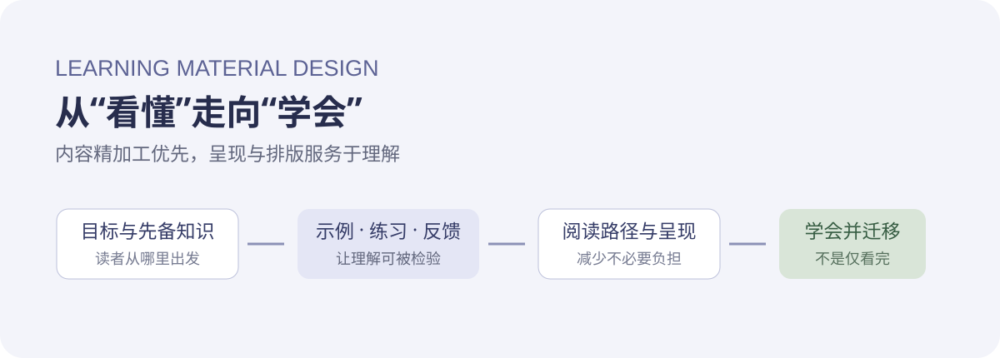

# learning-material-design



用教育心理学设计和精加工学习材料，不只是把页面排得好看。

它把材料分成三层处理：

1. **内容层**：学习目标、先备知识、概念、例子、反例、练习、反馈。
2. **结构层**：切片、顺序、信号、复习、迁移。
3. **呈现层**：阅读路径、信息邻近、图表和可访问性；最终文件渲染由办公或项目工具负责。

## 适合

- 课程讲义、培训手册、操作教程、知识库文章、自学材料。
- 把专家内容改写成初学者能理解、能练习的版本。
- 给现有材料补例子、检查题、反馈和迁移任务。
- 检查一份材料是否“看完了但没学会”。

## 安装

本 Skill 是本地能力 Skill，不依赖外部 API。把整个 `learning-material-design` 目录放到 Agent 的 skills 目录即可，例如：

```text
~/.agents/skills/learning-material-design
```

使用支持自定义技能目录的宿主时，也可放在其用户级或项目级技能目录中。目录中保留 `SKILL.md`、`README.md` 和 `references/`。

也可以使用：

```bash
npx skills add hayou2002/learning-material-design
```

## 不适合

- 普通办公报告、会议纪要、方案、正式公文：`wf-office`。
- 学科学习计划、进度记录、题目讲解、错题管理：`wf-study`。
- 纯视觉设计、品牌、界面：`wf-design`。
- 只做文字润色：`oil-tone`。

## 使用

可以直接说：

```text
把这份课程讲义改成初学者能理解、能练习的版本，补例子、反例和检查题。
```

```text
检查这份培训材料为什么看完记不住，按教育心理学原则重排，并给出修改说明。
```

```text
把这份知识库文章整理成学习材料：目标、先备知识、示例、练习、反馈和复习安排。
```

本 Skill 先做内容与结构诊断，再处理版式。需要生成 Word/PDF/PPT 文件时，交 `wf-office`；需要学科计划、题目讲解和错题记录时，交 `wf-study`。

## 核心流程

```text
学习结果与读者
→ 先备知识与误区
→ 任务分解与排序
→ 切片与信号
→ 解释、示例与反例
→ 练习、反馈与元认知
→ 间隔、交错与迁移
→ 版式、无障碍与审查
```

## 关键文件

- `references/educational-psychology.md`：认知负荷、多媒体学习、提取、间隔、交错、专家反转等原则与边界。
- `references/content-refinement.md`：把信息堆砌改成学习序列的具体改法。
- `references/layout-and-accessibility.md`：Word、PDF、PPT、网页的阅读与排版规则。
- `references/audit-checklist.md`：内容、结构、表面三通道检查。
- `references/evidence-sources.md`：权威指南、开放教材、GitHub 索引的检索顺序、证据与许可边界。

## 配置

不需要 API Key、模型配置或账号。可按项目需要补充：

- 读者画像、课程标准和单位模板。
- 术语表、示例库、题库和错题记录的位置。
- 材料交付格式和品牌/版式规范。

这些配置属于项目事实，优先写在项目自己的 `AGENTS.md`、`DESIGN.md` 或工作流 `work/` 下，不写进本 Skill。

## 兼容性与依赖

- 纯 Markdown 参考，不依赖 Python、Node 或浏览器。
- 可单独使用，也可与 `wf-study`、`wf-office`、`oil-tone`、`create-viz`、`data-visualization` 配合。
- 图表生成和文件渲染由对应工具负责；本 Skill 只给内容与版式判断。
- 不读取凭据，不向外部服务发送材料。

## 边界与隐私

- 本 Skill 不验证材料中的事实和引用；外部事实仍需回原始来源核对。
- 不把学习风格当作科学分班依据，不把相关性写成因果。
- 不替代学科教学判断、考试政策解读或医疗/法律等专业意见。
- 材料中的个人信息、学生数据、合同和凭据应按项目权限处理；不要把敏感原文复制到无关对话或公开仓库。

## 与工作流配合

- `wf-study` 负责学什么、何时学、练习记录和错题；本 Skill 负责材料怎么精加工。
- `wf-office` 负责 Word/PDF/PPT 文件生产、图表插入和渲染验收。
- `oil-tone` 负责语言表达；`create-viz` / `data-visualization` 负责数据图表。

## 许可

[MIT](LICENSE)
